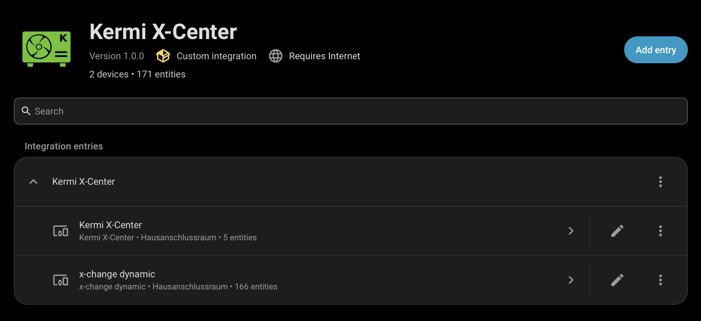
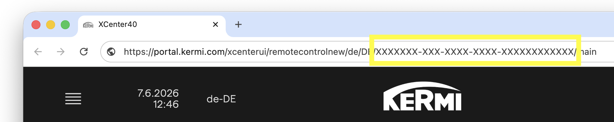
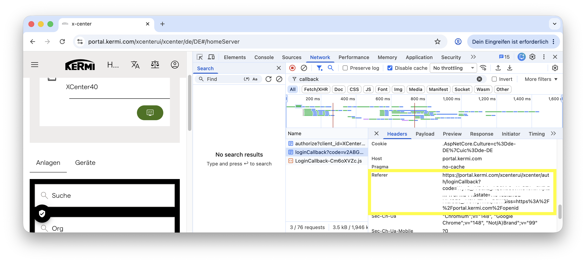

# Kermi X-Center Cloud API integration for Home Assistant
Connect your Kermi X-Center heat pump to Home Assistant through its cloud portal (no Modbus or local HTTP API access required). Discover available datapoints, monitor system status, and control supported settings directly from Home Assistant.

## Features
- Cloud-based OAuth authentication
- Automatic discovery of available datapoints, including favorites
- Read and write support for datapoints the portal allows users to control
- Configurable data refresh interval
- Support for the Kermi and HEIM AG cloud portals

## Disclaimer
🚨 This custom component is an independent project and is neither affiliated with nor endorsed by Kermi GmbH or Heim AG. Trademarks and product names belong to their respective owners. Use this integration at your own risk. It may affect your manufacturer's warranty or cause damage if used incorrectly. 🚨

## Requirements
### Hardware Compatibility
This integration has been tested with:
- Kermi x-center X40 controller, firmware 1.5.110.260
- Kermi x-center pro controller, firmware 1.6.5.44
- Kermi x-change dynamic and x-change dynamic pro heat pumps

Other heat pumps and devices connected to a compatible x-center controller may also work, but have not been confirmed.

### Cloud portal and remote access
The x-center controller must be connected to the internet and registered with the cloud portal. Remote access to the installation must be enabled in that portal.

| Portal | Address |
| --- | --- |
| Kermi | [portal.kermi.com/xcenterui](https://portal.kermi.com/xcenterui) |
| HEIM AG (Switzerland) | [kermi.heim-ag.ch/xcenterui](https://kermi.heim-ag.ch/xcenterui) |

## Installation

### Via Home Assistant [Marketplace](https://next.home-assistant.io/integrations/marketplace/) (recommended)

1. In Home Assistant, go to Settings > Marketplace .
2. Open the three-dot menu.
3. Select **Custom repositories**.
4. Add this [custom repository](https://hacs.xyz/docs/faq/custom_repositories) URL: https://github.com/afmklk/hacs-krmi-xcntr 
5. Set category to **Integration**.
6. Install **Kermi X-Center**.
7. Restart Home Assistant.

### Manual
Copy `custom_components/kermi_xcenter` into your Home Assistant config directory.

## Configuration

### Find your installation ID

Log into the x-center portal at https://portal.kermi.com/xcenterui/ (or https://kermi.heim-ag.ch/xcenterui/ if based in Switzerland). Copy the installation ID from that page's URL (see screenshot). The installation ID is not the same as the heat pump's serial number. Log out of the portal in your browser after retrieving the installation ID.

### Add the integration

1. In HA, go to **Settings → Devices & services**, click **Add Integration** and search for **Kermi X-Center**.
2. Paste your installation ID and select the matching portal (Kermi or Heim AG).
3. Copy the resulting auth URL.
4. In a new browser window/tab, open **Developer tools → Network**.
5. Paste and open the auth URL.
6. Log in.
7. In Network search/filter for the `loginCallback` request. Double-click to inspect Headers and copy the **Referer** from the **Request Headers** section. It should look something like `https://portal.kermi.com/xcenterui/xcenter/auth/loginCallback?code=...&state=...&iss=https%3A%2F%2Fportal.kermi.com%2Fopenid`
   
8. Paste that URL back into the Callback Referer URL field in HA. If you get an "invalid_state" error, make sure you actually copied the callback's **Referer URL**, not the **Request URL**.
9. Done! 

Optional: By default, data from the cloud portal will be refreshed every 5 minutes. You can configure custom refresh intervals in the options flow (⚙️ icon).

## Troubleshooting

- Make sure the selected portal matches the one where your x-center controller is registered.
- If setup fails after you authenticate, update to **v1.0.5 or newer**, then reload the integration.
- If the problem continues, enable debug logging for `custom_components.kermi_xcenter` and review the Home Assistant logs.